<div align="center">



<br />

<a href="https://www.linkedin.com/in/aungkhantthaw/"></a>
<a href="https://veloverse.site"></a>
<a href="https://github.com/NikolaTW7?tab=repositories"></a>


</div>


## ◈ 01 · About

I'm **Aung Khant Thaw** (Nikola), a second-year **BSc Computer Science** student at **Queen's University Belfast**, looking for a **2027 software engineering placement**.

I learn best by building complete projects: a live full-stack web application, a Windows desktop media player and team database and design projects. Along the way I've worked on requirements, UML design, testing and documentation, not only code.

Long term, I want to connect software with **robotics** and **intelligent systems**.

```text
> profile --summary
  name        Aung Khant Thaw (Nikola)
  study       BSc Computer Science, Queen's University Belfast (Year 2)
  objective   2027 software engineering placement
  interests   Software engineering · Robotics · Artificial intelligence · Space technology
```


## ◈ 02 · Technology Stack

### Used in my projects and coursework

**Languages**<br />


**Web, back end and data**<br />


**Desktop and multimedia**<br />


**Tools and deployment**<br />


### Currently exploring


<sub>Exploring means learning and experimenting, not yet used in a completed project.</sub>


## ◈ 03 · Featured Projects



A live bicycle education website covering bicycle types, components, materials, brands and models.


- Structured bicycle information and model comparisons backed by a PostgreSQL database
- Server-rendered pages with Spring Boot and Thymeleaf, deployed on Railway
- **84 passing automated tests**
- Next (planned): interactive 3D bicycle models and animated explanations of components

**[Visit veloverse.site](https://veloverse.site)** · **[Source code](https://github.com/NikolaTW7/veloverse)**

<br />



A completed Windows desktop media player built with C++/CLI, Windows Forms and libmpv.


- MP3 and MP4 playback with playlists, seeking, shuffle and repeat
- Karaoke vocal reduction using an FFmpeg audio filter
- Full-screen mode with floating controls, automatic cursor hiding and keyboard shortcuts
- Engineered with requirements documentation, system architecture, UML diagrams and a manual test checklist

The source code and documentation are public. A downloadable executable is not published.

**[Source code and documentation](https://github.com/NikolaTW7/MP3-MP4-Media-Player)**

<br />



A database-driven web application for managing donated technology and equipment allocation, built by a team of five.


### My contributions

- SQL reporting queries using joins, grouping and aggregate functions
- A database view to support the reports
- Interactive Chart.js charts built from the query results

**[View the project site](https://haung02.webhosting1.eeecs.qub.ac.uk/)**

<br />



An ongoing six-person project: a turn-based educational board game about climate change.


- Current stage: software requirements, use cases, UML modelling, system architecture and gameplay design
- Implementation in Java is planned for a later stage


## ◈ 04 · Engineering Interests and Robotics

```text
CURRENT FOCUS                         EXPLORING
------------------------------        ------------------------------
[+] C++ and object-oriented design    [>] Arduino and microcontrollers
[+] Software design and architecture  [>] Electronics and sensors
[+] Testing and debugging             [>] CAD for mechanical parts
[+] Java back-end development         [>] Robotics
[+] Relational databases              [>] Artificial intelligence
```

### Future projects

These are planned directions, not finished work.

| Project | Direction |
| --- | --- |
| Personal AI assistant | Voice and text interaction, memory, AI APIs and permission-controlled task automation |
| 3D VeloVerse | Interactive bicycle models and animated mechanical components |
| 2D Java game | Game loop, event handling, collisions and object-oriented design |
| Robotics experiments | Arduino, electronics, sensors, CAD and embedded software |

I'm especially interested in autonomous systems and sensor integration, and in how intelligent and robotic systems can support scientific research and space exploration.


## ◈ 05 · GitHub Activity

<div align="center">


</div>


## ◈ 06 · Connect

<div align="center">

**Open to software engineering placement opportunities for 2027.**

<a href="https://www.linkedin.com/in/aungkhantthaw/"></a>
<a href="https://github.com/NikolaTW7"></a>
<a href="https://veloverse.site"></a>
<a href="https://github.com/NikolaTW7/MP3-MP4-Media-Player"></a>


</div>
